<div align="center">



[🌐 Portfolio](https://shubham-ai-lab.vercel.app/) · [👤 GitHub profile](https://github.com/Shubham261299) · [💼 LinkedIn](https://www.linkedin.com/in/shubham-jamdar-2571271b3)

</div>

# The Last Witness

A local cinematic detective game: investigate a museum theft, question three staff members, compare twelve source records, reconstruct the timeline and submit an evidence-backed report. V1 implements one fixed replayable case with deterministic scoring and SQLite persistence.

V1 implementation was approved on 14 October 2026. It includes the complete investigation/report/replay loop and bounded local Ollama routing with authored fallback. See [verification and limitations](docs/V1_VERIFICATION.md) and [dependency review](docs/DEPENDENCY_REVIEW.md).

## Planning documents

- [Project brief and decision log](project.md): product scope, stack direction, constraints, and milestones.
- [V1 prototype delivery plan](docs/V1_PROTOTYPE_PLAN.md): approved scope, task list and delivery gates.
- [Case 001 design](docs/case-001/CASE_DESIGN.md): provisional case facts and preserved evidence corrections, progression, scoring, and submission/replay rules. Contains the full solution.
- [Case 001 character dialogue](docs/case-001/CHARACTER_DIALOGUE.md): voices, disclosure boundaries, and scripted responses.
- [Case 001 review checklist](docs/case-001/REVIEW_CHECKLIST.md): fairness, consistency, leakage, and future acceptance scenarios.
- [UI/UX design specification](docs/UI_DESIGN.md): draft screens, player journeys, visual system, components, accessibility, and recovery states.
- [Repository instructions](AGENTS.md): working conventions and project rules.

The corrected case remains fixed for V1. [Contracts](docs/V1_CONTRACTS.md) describe state, API, dialogue and retry behaviour; [acceptance mapping](docs/V1_ACCEPTANCE_MAP.md) connects the design scenarios to checks. Case and UI documents contain author-facing spoilers and are never served as player assets.

## Run locally on Windows

Use PowerShell from this project directory. Requirements: Node 24, npm 11 and Python 3.13. Ollama is optional; the entire case works with scripted dialogue. The validated local default is `llama3.1:8b`; setup does not download models.

Dependencies are installed on the current machine. For a fresh installation with internet access:

```powershell
.\scripts\setup.ps1
```

Setup installs `backend/requirements-lock.txt` and uses `npm ci --prefix frontend --ignore-scripts`. Pending package scripts remain disabled. If PowerShell scripts are restricted, use these equivalent commands without changing machine-wide execution policy:

```powershell
python -m venv backend/.venv
.\backend\.venv\Scripts\python.exe -m pip install -r backend/requirements-lock.txt
npm ci --prefix frontend --ignore-scripts
```

Backend terminal:

```powershell
.\scripts\start-backend.ps1
```

Equivalent: `.\backend\.venv\Scripts\python.exe -m uvicorn witness.app:create_app --factory --app-dir backend --host 127.0.0.1 --port 8000`.

Frontend terminal:

```powershell
$env:NEXT_TELEMETRY_DISABLED = '1'
npm --prefix frontend run dev
```

Open **http://127.0.0.1:3000**. Health: http://127.0.0.1:8000/api/health. Stop each server with Ctrl+C. For a production preview, run `npm --prefix frontend run build`, then `npm --prefix frontend run start` instead of `dev`.

## First-time investigation help

Use **How to investigate** on any screen for a six-step, spoiler-free walkthrough. Short screen hints appear on first visits; **Got it** remembers dismissal in this browser while the guide stays available. Expand the small help panels beside records, questioning, comparison, timeline, notes and report controls for the next action. Help never selects answers or evidence, unlocks records, reveals the solution or creates an attempt.

## Play, save and replay

Read the briefing, inspect initial records and follow visible dossier requests. No required source depends on a confession or a typed phrase. Ask free-text questions or use stable topics; explicitly present discovered sources to challenge an account. Save comparisons as private interpretations. The timeline labels observations by their sources rather than declaring the culprit.

The report has three sections and a complete eight-claim review. Select **one record for each evidence role**; required multi-record combinations remain valid. Collecting records alone earns no citation credit. Incomplete reports can be submitted. Each new confirmed submission creates an immutable attempt; retrying an uncertain confirmation reconciles that same attempt. Notes are unscored and never submitted. Detailed feedback and reconstruction require separate spoiler confirmation after a submission.

Continue investigating and submit again, or replay. Replay clears working evidence, conversations, notes and draft while preserving historical submissions and their original citations/scores. Normal data lives in `backend/data/witness.db`; use the game control rather than deleting the database. Unsaved text remains in page memory and is not guaranteed after reload. Use Reconnect / retry after disconnection before sending another action.

## Dialogue settings

`backend/.env.example` documents settings; it is not automatically loaded. Set variables in the backend terminal. For scripted play use `.\scripts\start-backend.ps1 -Dialogue scripted`. To select another installed model, set `$env:WITNESS_OLLAMA_MODEL = 'model:tag'` before starting. Default provider: localhost:11434; default model deadline: 30 seconds. At ten seconds the interface offers an authored reply for a pending question. Provider failure or invalid output falls back safely. The model selects a visible topic; authored eligibility rules determine factual dialogue. No cloud inference or unrestricted generated testimony.

## Verify

```powershell
.\backend\.venv\Scripts\python.exe -m pytest
.\backend\.venv\Scripts\python.exe -m pytest backend/tests/test_scoring.py
npm --prefix frontend run typecheck
npm --prefix frontend run lint
npm --prefix frontend run format:check
npm --prefix frontend run build
```

Browser checks change a disposable investigation. Stop the normal backend, start `.\scripts\start-backend.ps1 -Test`, keep the frontend running, then run:

```powershell
.\backend\.venv\Scripts\python.exe scripts/check_browser.py
.\backend\.venv\Scripts\python.exe scripts/check_recovery.py
.\backend\.venv\Scripts\python.exe scripts/check_guide.py
```

All browser checks refuse a normal backend; test data is `.cache/browser.db`. On a fresh machine install Chromium with `.\backend\.venv\Scripts\python.exe -m playwright install chromium`. The game does not require Playwright. `scripts/check_models.py` evaluates already installed candidates.

Fresh network installation could not be verified inside the agent sandbox. Python checks used a virtual environment with access to existing system packages; frontend installation succeeded in the user's terminal. Five reported high-severity findings remain in the lint dependency chain. No force-fix or pending script approval was performed. First-time 10–20 minute pacing and full screen-reader/device testing remain unmeasured.

## Layout

- `frontend/`: Next.js, TypeScript, React, Tailwind and original SVG assets.
- `backend/witness/`: FastAPI/Pydantic, authored content, deterministic rules and SQLite.
- `backend/tests/`: scoring, dialogue, disclosure and API regression tests.
- `scripts/`: local setup/start and verification tools.
- `docs/`: approved baseline, contracts and verification evidence.
